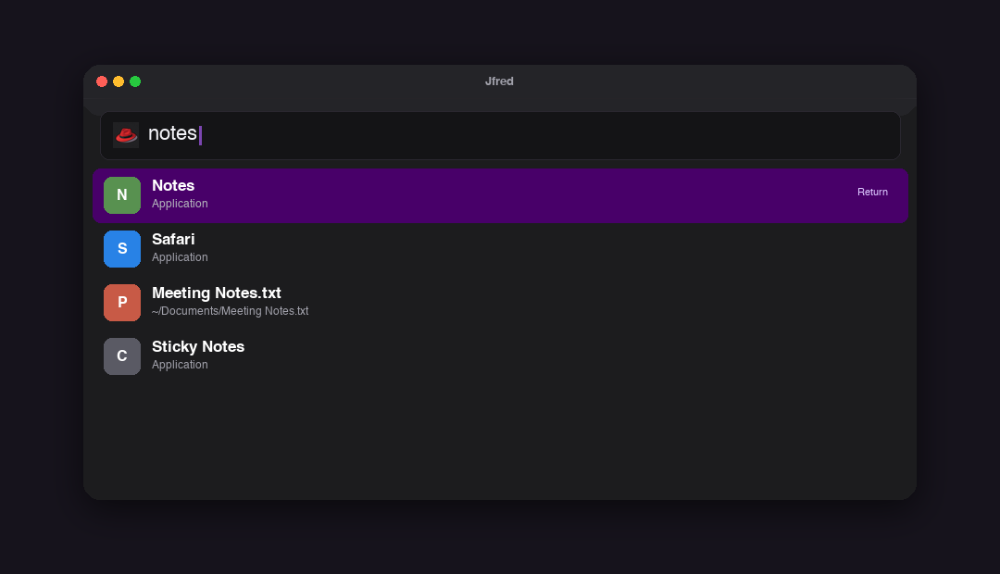
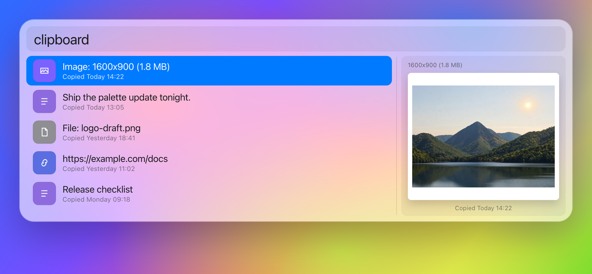
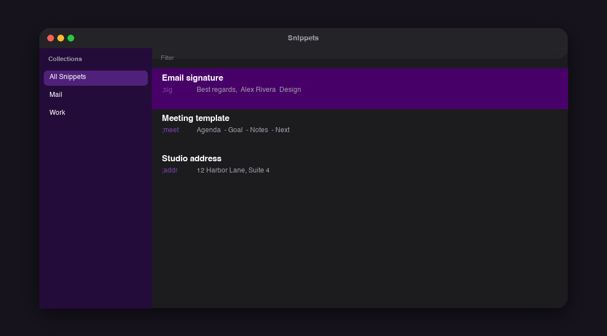
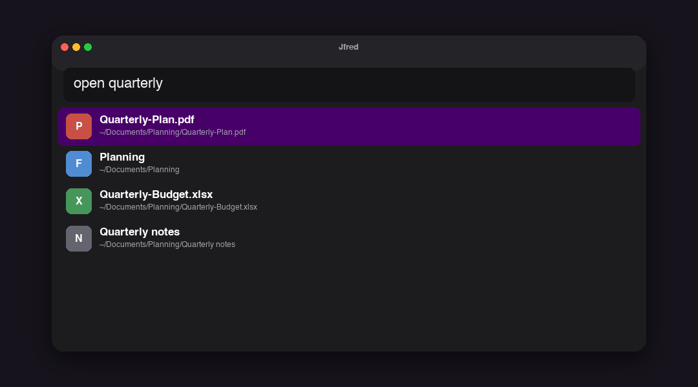
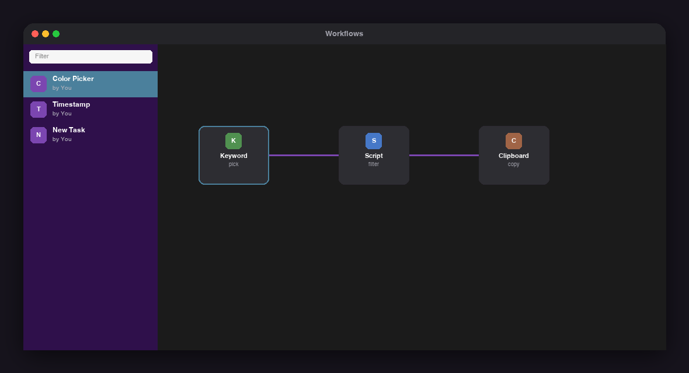
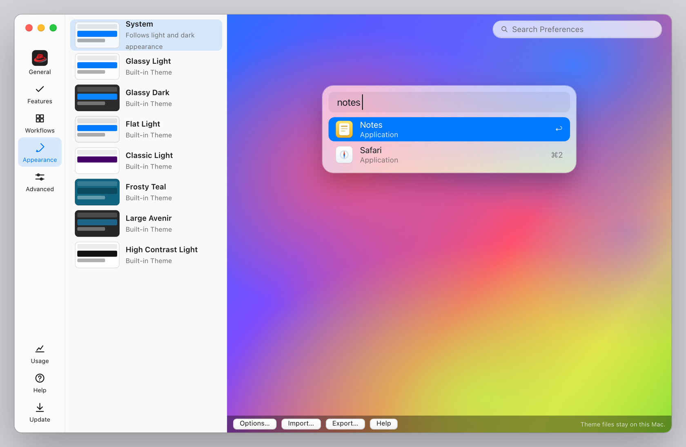
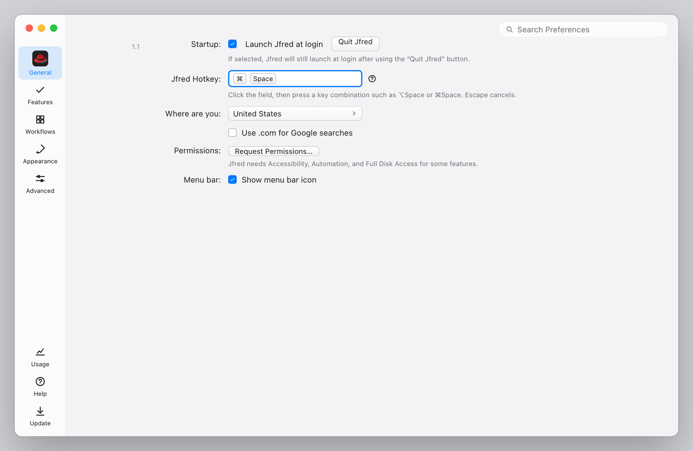
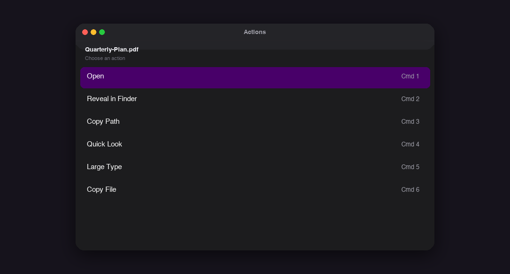
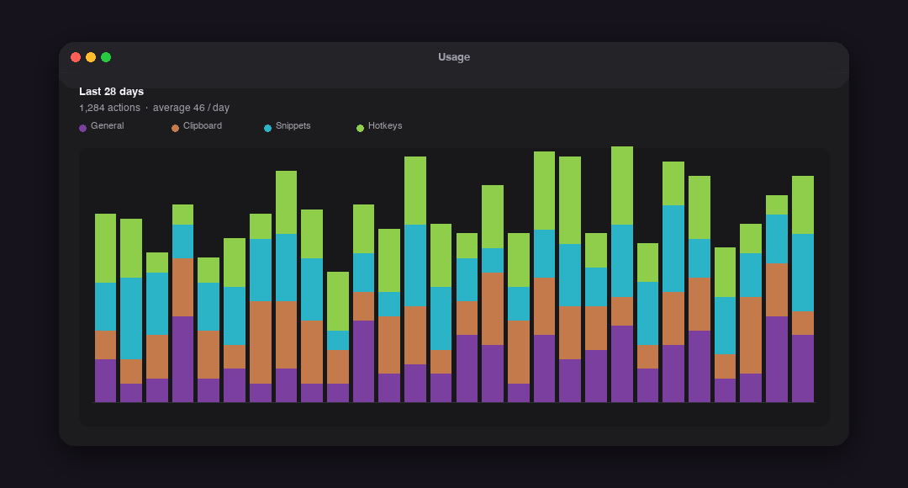
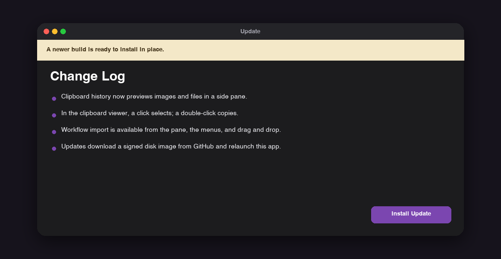

<p align="center">
  
</p>

<h1 align="center">Jfred</h1>

<p align="center"><strong>按一下快捷键，继续你的工作。</strong></p>

Jfred 是一款运行在菜单栏里的 macOS 启动器。同一个快捷键可以搜索应用和文件、翻看带预览的剪贴板历史、展开文本片段、执行你导入的工作流，并在应用内完成更新。数据留在这台 Mac 上，不需要账号，也不会把使用情况发送到别处。

默认快捷键是 ⌘Space，可随时在偏好设置里更改。Jfred 平时不占用 Dock，只有打开偏好设置时才会出现在程序坞中。

## Jfred 1.0

Jfred 1.0 是一次正式发布：把启动器里已经做稳的能力收在同一个快捷键下，数据仍然只留在这台 Mac 上，不需要账号。

**启动与搜索。** 同时匹配应用、文件、网页搜索、系统命令和你启用的其他来源，并按使用习惯排序；空查询时可以先看到最近用过的应用和剪贴板条目。

**剪贴板历史。** 右侧预览当前选中的文本、图片或文件。单击只用于选中并更新预览，双击或回车才会复制；滚轮不会误触发复制。

**文本片段。** 为常用文字设置关键字，输入后自动展开，也可以在剪贴板查看器里搜索插入。

**文件搜索。** 用关键字查找，或直接输入路径浏览目录，需要时用 Quick Look 预览，或把文件送进通用操作。

**工作流。** 用关键字、脚本、过滤器和动作搭处理链路，也可以导入兼容的工作流包。脚本过滤结果和只输入关键字时的补全行，都会尽量显示工作流自己的图标（包括 PNG、ICNS 和 PDF），而不是占位符。

**外观、快捷键与通用操作。** 内置主题可复制和微调；启动器热键、选中内容的通用操作热键，以及工作流自己的热键都可以在偏好设置里录制。

**应用内更新。** 更新页检查公开的 GitHub Release，校验官方磁盘镜像后替换当前拷贝。请先把应用放在「应用程序」文件夹中。

下面是各项功能的更完整说明。


<p align="center">
  
</p>

## 启动器

输入几个字，Jfred 会同时匹配应用、文件、网页搜索、系统命令和你启用的其他来源。结果按使用习惯排序，常用项会更快出现在前面；空查询时可以先看到最近用过的应用和剪贴板条目。回车打开当前项，也可以用修饰键执行别的操作。

## 剪贴板历史

打开剪贴板查看器后，左侧是历史列表，右侧会预览当前选中的内容：图片按比例显示在白色画板里，并标出尺寸和大小；文件则显示图标和路径；文本保持原样。单击只用于选中并更新预览，双击或回车才会复制（并可按设置自动粘贴）。滚轮只滚动列表，不会误触发复制。密码管理器等来源默认不会进入历史。

<p align="center">
  
</p>

## 文本片段

为常用文字设置关键字，输入后自动展开，也可以从剪贴板查看器里搜索并插入片段。片段可分组管理，支持声音和剪贴板恢复等展开选项。自动展开需要辅助功能权限。

<p align="center">
  
</p>

## 文件搜索

用关键字搜索文件和文件夹，也可以直接输入路径浏览目录。可以限定搜索范围、文件类型和结果数量，回车打开文件或进入文件夹。需要时还能用 Quick Look 预览，或把文件送进通用操作。

<p align="center">
  
</p>

## 工作流

用关键字、脚本、过滤器和动作搭一条自己的处理链路，也可以导入兼容的工作流包。在工作流页面里，可通过导入按钮、菜单或把文件拖进去完成导入；导入结果会显示成功或失败提示，包会被复制到 Jfred 自己的本地库中，不会改动你的其他数据。画布上可以编辑对象、连接和调试运行过程。

<p align="center">
  
</p>

## 外观与主题

内置多套启动器主题，也可以把某个主题复制为自定义方案，调整窗口宽度、圆角、字号和颜色，并立即在预览里看到效果。主题可以导入或导出为外观文件，方便备份和分享。

<p align="center">
  
</p>

## 快捷键

启动器热键、选中内容的通用操作热键，以及工作流自己的热键都可以在偏好设置里录制和更改。如果某个组合已被其他应用占用，页面会给出提示。还可以选择登录时自动启动。

<p align="center">
  
</p>

## 通用操作

对当前结果或系统里选中的文本、文件执行打开、在访达中显示、复制路径、Quick Look、大号文本等操作。动作面板支持快捷键选择，也可以按最近使用顺序排列。

<p align="center">
  
</p>

## 大号文本

把一段文字以全屏大字显示在桌面上，适合隔空给别人看一句号码、名称或确认信息。字号和字体可在设置中调整。

<p align="center">
  
</p>

## 使用统计

在偏好设置的用量页查看最近一段时间的操作次数和分类趋势，例如一般搜索、剪贴板、片段和快捷键。统计只保存在本地，可以随时清除。

<p align="center">
  
</p>

## 应用内更新

更新页会检查公开的 GitHub Release，下载对应架构的官方磁盘镜像，在校验通过后替换当前的 Jfred.app 并重新启动。检查过程不会发送使用数据。请先把应用放在「应用程序」文件夹中再使用这个功能。是否包含预发布版本可以在设置里选择。

<p align="center">
  
</p>

## 其他功能

这些功能同样内置在 Jfred 中，可在偏好设置里单独开关：

- 计算器与单位换算
- 词典与拼写
- 自定义网页搜索、书签和浏览记录
- 系统命令（休眠、退出应用、推出磁盘等，可逐项开关）
- 把命令送到终端应用
- 通讯录搜索
- 音乐播放与迷你播放器
- 1Password 书签
- 文件与结果的预览

## 安装

1. 从 [GitHub Releases](https://github.com/weijing24/Jfred/releases) 下载最新的 `Jfred-*-arm64.dmg`。
2. 把 Jfred 拖进「应用程序」文件夹。
3. 首次启动请右键点 Jfred.app，选择「打开」。应用使用稳定的自签名证书，未经 Apple 公证；也可以在终端执行 `xattr -cr /Applications/Jfred.app` 后再打开。
4. 之后的版本可以通过应用内更新安装。更新程序会在替换应用前移除隔离属性，并校验签名。

## 系统要求

- macOS 14 或更高版本
- 官方发布的磁盘镜像目前为 Apple Silicon（arm64）

## 从源码构建

需要 Xcode 或对应的命令行工具，以及 Swift 6。

```bash
git clone https://github.com/weijing24/Jfred.git
cd Jfred
./scripts/test.sh
./scripts/build-app.sh
open build/Jfred.app
```

本地制作磁盘镜像：

```bash
./scripts/package-dmg.sh
```

镜像会出现在 `dist/Jfred-<版本>-<架构>.dmg`。
